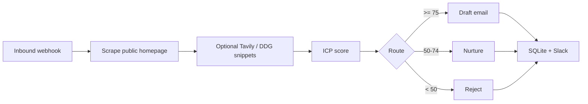

# Lead Qualification Agent

Inbound webhook that reads a **public company homepage**, scores the account against a **written ICP rubric**, routes it (`qualify` / `nurture` / `reject`), and drafts a short outreach email for qualified leads.

Local-first: Ollama by default, Groq or OpenAI by changing `.env`. If the model is down, a deterministic rubric still scores the lead so the pipeline does not stall.

This is an **internal sales-ops tool**, not a bulk scraper or spam cannon. It fetches one public homepage per inbound lead, honors `robots.txt`, and rate-limits through a single HTTP client.

## Why this exists

Most “AI SDR” demos hide the score. Clients do not buy that. This repo makes the decision path inspectable:

- exact 100-point rubric in `src/engine/scoring.py`
- LangGraph nodes: `scrape → enrich → score → route → draft → persist`
- SQLite audit log of every decision
- optional Slack notification with the same breakdown

## Architecture



## ICP rubric

| Dimension | Points | What it rewards |
| --- | --- | --- |
| Company size | 0–20 | 10–500 employees when provided |
| Industry | 0–20 | SaaS, logistics, fintech, healthcare, professional services, manufacturing, cybersecurity |
| Geography | 0–15 | US / Canada / UK / EU |
| Buying signal | 0–25 | Pricing, demo CTA, hiring, SOC 2 / HIPAA / GDPR, integrations |
| Data completeness | 0–20 | Successful fetch, contact, clear offering |

Thresholds (override in `.env`):

- `QUALIFY_THRESHOLD=75`
- `NURTURE_THRESHOLD=50`

## Quick start

```bash
python -m venv .venv
source .venv/bin/activate
pip install -e ".[dev]"
cp .env.example .env
mkdir -p data
uvicorn api.main:app --reload --app-dir src
```

Send a lead:

```bash
curl -s http://127.0.0.1:8000/webhook/inbound-lead \
  -H 'Content-Type: application/json' \
  -d '{
    "company_name": "Example Freight",
    "website": "https://example.com",
    "contact_name": "Ada",
    "contact_email": "ada@example.com",
    "claimed_employees": 80,
    "claimed_country": "United States",
    "source": "inbound-form"
  }'
```

Optional local model (same OpenAI-compatible client):

```bash
ollama pull qwen2.5:7b
```

Docker:

```bash
cp .env.example .env
docker compose up --build
```

## API

| Method | Path | Purpose |
| --- | --- | --- |
| `GET` | `/health` | Liveness |
| `POST` | `/webhook/inbound-lead` | Score and route one lead |
| `GET` | `/leads` | Recent decisions |
| `GET` | `/leads/{id}` | Full payload including rubric and draft |

## Tests

```bash
pytest -q
```

CI runs the same suite on every push. Network and Slack are mocked; the heuristic rubric is the source of truth in CI.

## What a client typically asks to customize

- Swap the ICP rubric for their real ICP
- Write qualified leads into HubSpot / Salesforce instead of SQLite
- Change the draft to their voice and CTA
- Add an allowlist of domains they already have permission to fetch
- Point `LLM_PROVIDER` at Groq or OpenAI for production latency

## Legal / ToS note

The scraper only requests the URL the caller supplies. Use it on public marketing sites you are allowed to fetch. Do not point this at authenticated apps, job boards with anti-bot terms, or purchased email lists.

## License

MIT
